# hekouwang · Typora long-form reading theme

Hekouwang turns Markdown into a calm, coherent reading surface for long-form writing—especially mixed CJK and Latin documents.

[中文产品说明](README.md) · [Live site](https://huiyonghkw.github.io/hekouwang-typora-theme/) · [Technical notes](README.zh.md)

## What it is

- CJK-oriented reading metrics: `1rem` body size and `1.65` leading. The paper follows the window with about `3rem` of gutter on each side; prose, headings, and lists sit in a centered reading column of `100vw − 16rem`, clamped to `48–96rem`. The paper is `6rem` wider than the reading column, leaving room for code and wide tables.
- Quiet hierarchy through size, weight, and space—not colored left bars or heavy chrome.
- A `1rem` top gap above the paper in regular windows; source and focus mode styles; inline images stay in the text flow. Tables and small text use `14px`, code fences `15px`; PDF paper size, margins, and headers follow Typora’s export settings.
- Inter for bundled Latin glyphs; system CJK fonts for small distribution size and clear licensing.
- A dedicated Windows layer using Typora's `body.os-windows`: Microsoft YaHei UI / Microsoft YaHei for CJK and Cascadia Mono / Cascadia Code for code.

Each generated theme runs a static text and control contrast audit during the build. The public repository checks the two free themes; with the local paid palette, the build checks twelve paid CSS files as well, fourteen in total. Use Typora itself to verify narrow windows, source and focus modes, code wrapping, and multipage PDF output.

### Free V2 · light and dark

These images were captured in Typora on macOS with the 1.3.1 CSS. The 2.0.0 CSS is already in this repository; 2.0.0 screenshots are pending.

| Light | Dark |
|---|---|
| 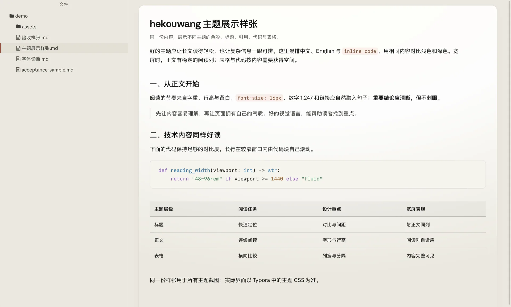 | 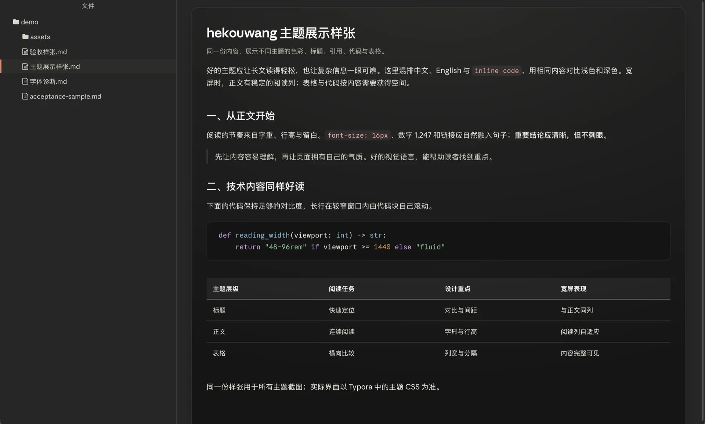 |

## Install

macOS:

```bash
git clone https://github.com/huiyonghkw/hekouwang-typora-theme.git
cd hekouwang-typora-theme
./scripts/install.sh
```

Windows PowerShell:

```powershell
git clone https://github.com/huiyonghkw/hekouwang-typora-theme.git
cd hekouwang-typora-theme
.\scripts\install-windows.ps1
```

If local policy blocks the script, run `powershell -ExecutionPolicy Bypass -File .\scripts\install-windows.ps1`; it applies only to that process and does not change the system policy.

Restart Typora completely, then choose **Hekouwang** or **Hekouwang Dark**. The Windows installer targets `%APPDATA%\Typora\themes`; use `-ThemeDir` for a custom location.

For a compact reading column, put `:root { --hk-reading-measure: 40rem; }` in `hekouwang.user.css` inside Typora’s theme folder (`hekouwang-dark.user.css` for Dark). Put it in `base.user.css` to share the preference across variants. Restart Typora after changing the file.

## Editions

| Edition | Themes | Notes |
|---|---|---|
| Free · MIT | Hekouwang / Hekouwang Dark | Complete V2 editorial reading experience. |
| Paid · ¥9.9 | Hekouwang V1 / V2 Pro / V3–V6 (+ Dark) | Six separate visual systems, twelve paid CSS files, built on the same reading metrics. |

Paid V2 Pro is a walnut and bronze editorial design with warm paper, double-line accents, and a clear sans-serif heading hierarchy; it is separate from the free V2 files and menu entries. The other paid directions are graphite and mint (V1), navy and brass (V3), frosted ice blue (V4), an amethyst shell with cyan signals in light mode and cool indigo with electric cyan accents in dark mode (V5), and plum, coral, and pink (V6).

### All six paid themes

These are **Typora screenshots on macOS using the latest 1.3.1 CSS**. Open an image for the full-size view. You can also [compare all light/dark pairs on the live site](https://huiyonghkw.github.io/hekouwang-typora-theme/#compare-shots).

| Paid theme | Light | Dark |
|---|---|---|
| **V1 · Graphite & mint** | 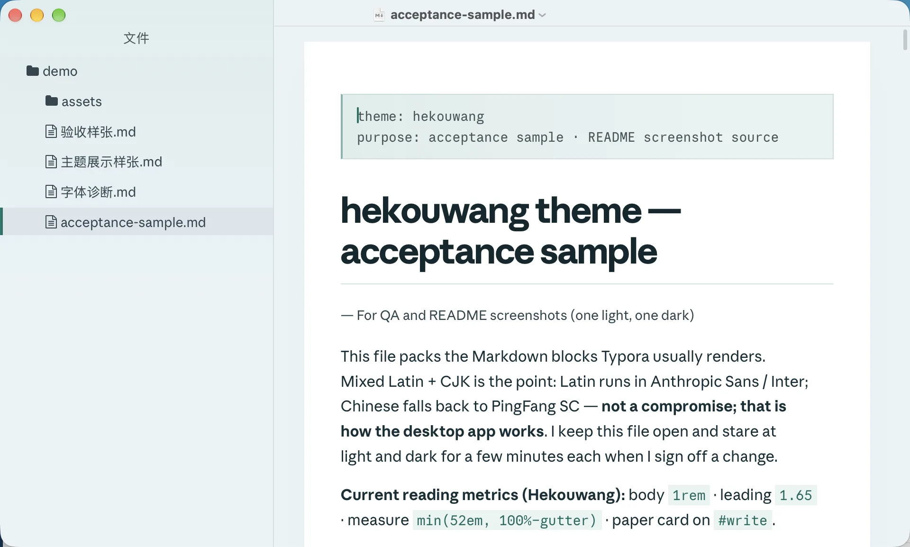 | 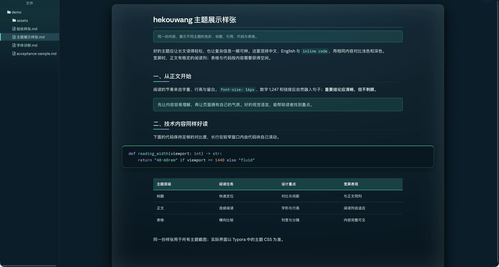 |
| **V2 Pro · Editorial** | 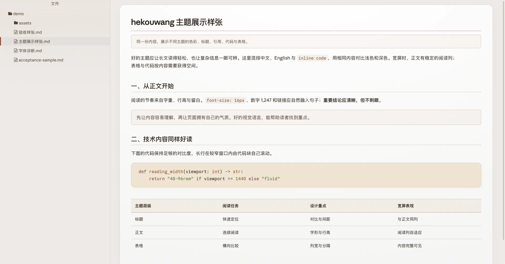 | 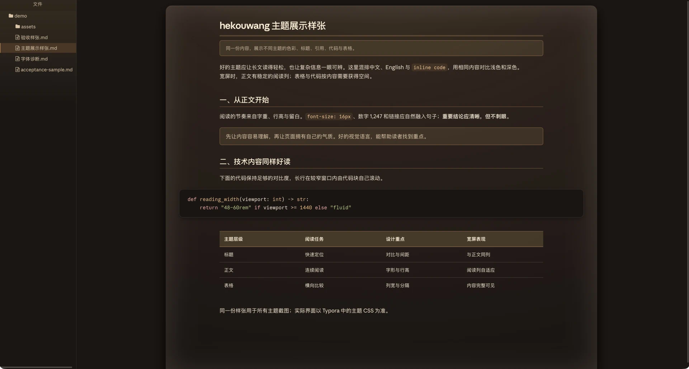 |
| **V3 · Finance** | 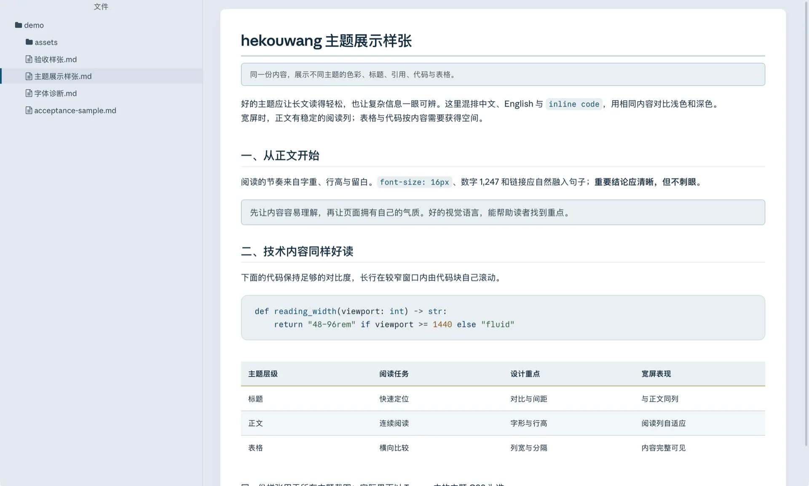 | 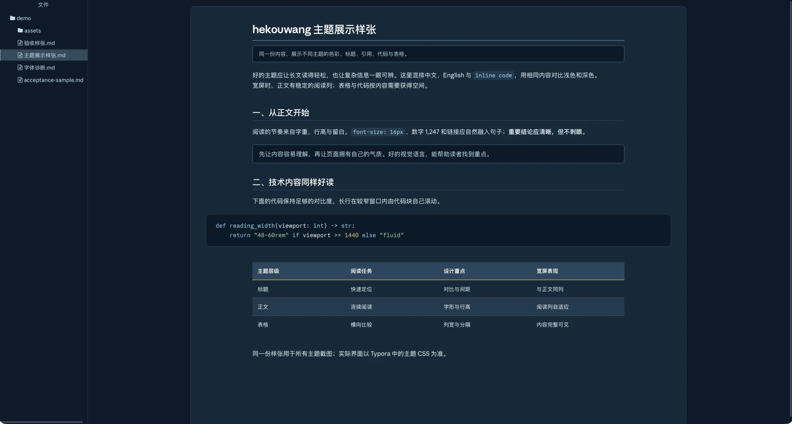 |
| **V4 · Glass** | 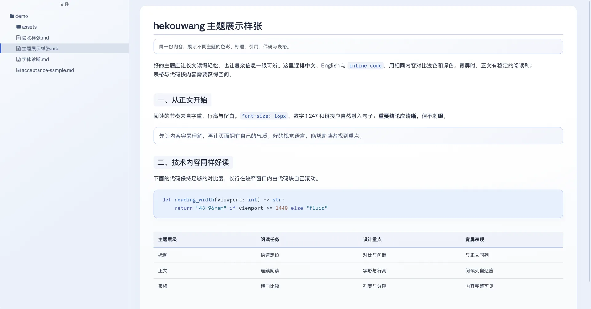 | 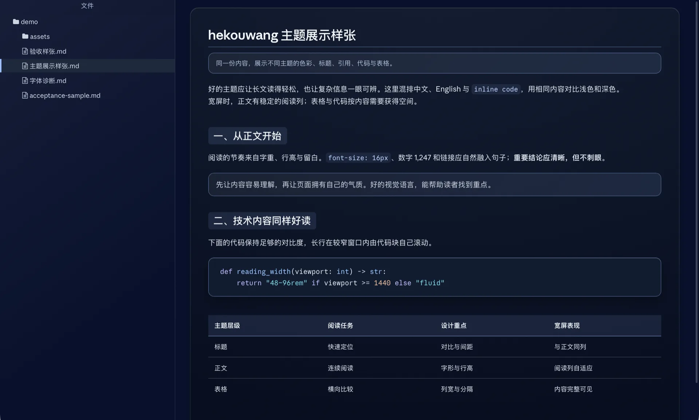 |
| **V5 · HUD** | 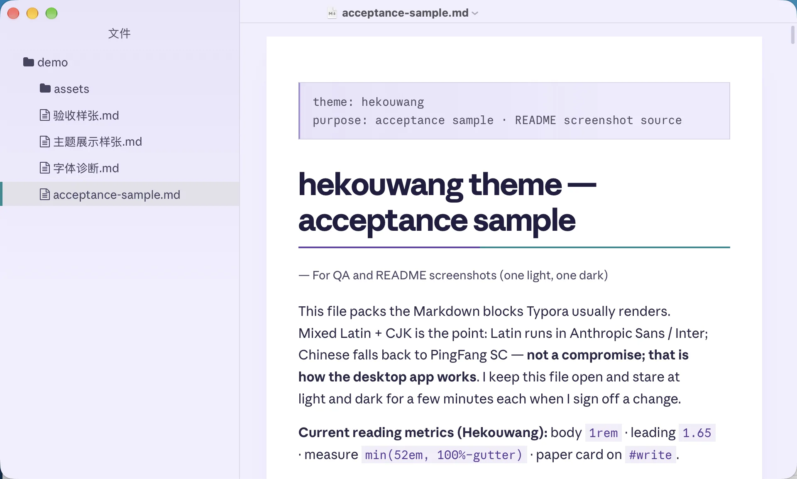 | 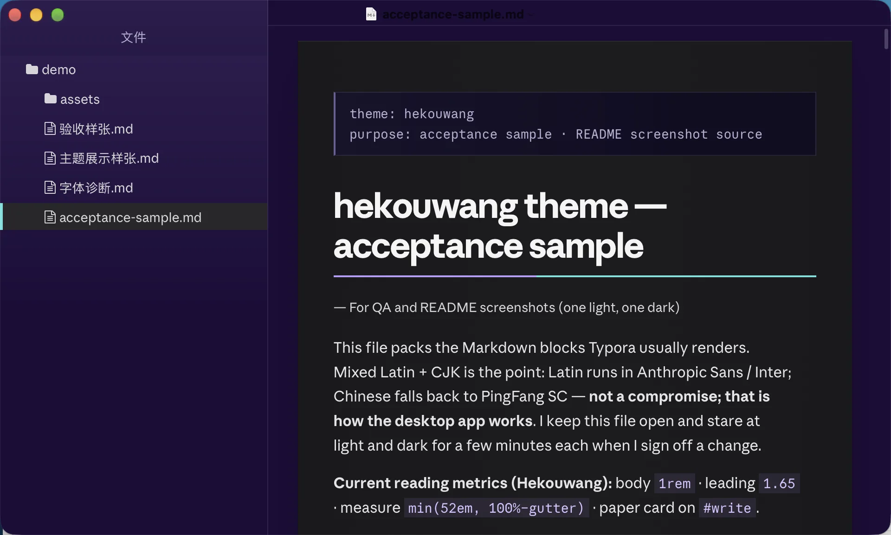 |
| **V6 · Ember** | 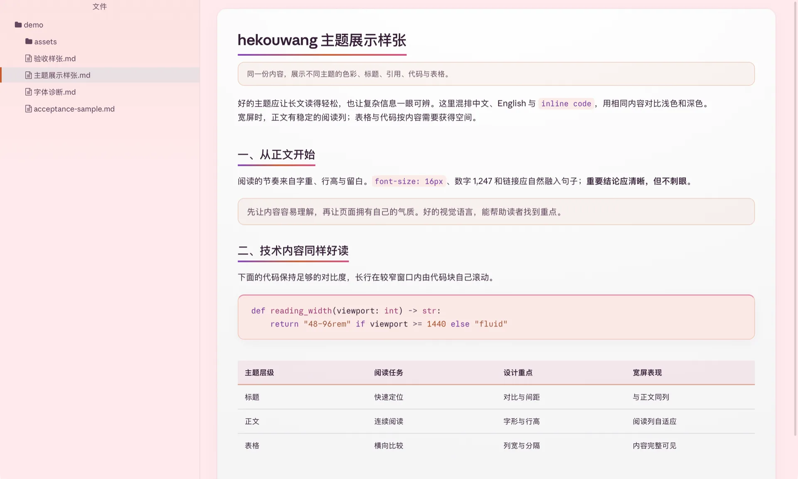 | 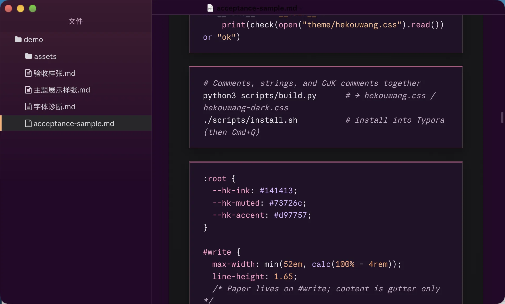 |

See the [live site](https://huiyonghkw.github.io/hekouwang-typora-theme/#buy) for the paid pack and the [2.0.0 upgrade guide](UPGRADE.md) for installation steps. The Chinese README is the canonical product page; see [README.zh.md](README.zh.md) for engineering detail.

## License

Free V2 and scripts are [MIT](LICENSE); bundled Inter is SIL OFL 1.1. Paid packs are personal-use only. No Anthropic font is included or redistributed.
