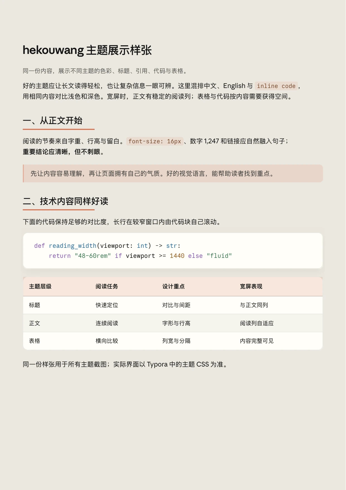

# hekouwang

**体验站：** [huiyonghkw.github.io/hekouwang-typora-theme](https://huiyonghkw.github.io/hekouwang-typora-theme/)

[2.0.1 升级说明](UPGRADE.md) · [English](README.en.md)

给「一天要盯着 Markdown 好几个小时」的人用的 Typora 主题——按**中文长文**来排，不是按聊天气泡来排。

付费包升级为 **六套独立视觉（V1 / V2 Pro / V3–V6）**，免费 V2 继续单独提供；阅读指标全套共用：正文 `1rem` · 行高 `1.65` · 纸面随窗口伸缩、两侧各留约 `3rem` · 居中的 `48–96rem` 响应式正文阅读列 · 纸感卡片。

## 免费 / 付费

| 档 | 主题菜单 | 说明 |
|---|---|---|
| **免费 · MIT** | **Hekouwang** / **Hekouwang Dark** | = skill **V2 编辑**（纯白纸面、暖灰外框、墨色标题、墨绿点缀、直角纸卡；深色墨玉黑）。Gallery 入口也是这一档。公开仓只发这一档。 |
| **付费包 · ¥9.9** | **Hekouwang V1 / V2 Pro / V3–V6**（各含 Dark） | 石墨青绿 / 典藏编辑 / 海军蓝财经 / 冰蓝玻璃 / 紫晶电青 HUD / 李紫焰彩，六套浅深共 12 个 CSS；**色板与工艺不进公开仓**，只随 zip 私发 |

**怎么买：** 落地页购买区（微信/支付宝 · 微信 `hekouwang`，备注「Typora主题」）→ 我私发 zip → 按落地页 [装付费包](https://huiyonghkw.github.io/hekouwang-typora-theme/#unlock) 一键装进 Typora。

→ [huiyonghkw.github.io/hekouwang-typora-theme/#buy](https://huiyonghkw.github.io/hekouwang-typora-theme/#buy)

免费色板在 `scripts/palettes.json`；付费色板不进公开仓。阅读指标在 `scripts/tokens.json`。公开仓重建：`python3 scripts/build.py`（默认只出免费档）。

## 快速验收

```bash
python3 scripts/build.py                    # 生成浅色+深色 CSS
python3 scripts/verify_layout.py --all      # 7 档窗口、窄屏和表格预检
python3 scripts/verify_export_pdf.py        # A4/A5 长代码、长表和页边距预检
./scripts/install.sh                        # 装进 Typora（自动备份）
python3 scripts/verify_render.py --css theme/hekouwang.css --fonts "Hekouwang Sans,Hekouwang Sans Fb" --vars bg-color,text-color
```

联系付费包：**微信 hekouwang**（备注「Typora主题」）· GitHub **@huiyonghkw**

---

## 免费档 · V2 编辑

公开仓 / Gallery 就是这一档：**Hekouwang** / **Hekouwang Dark**。同一套阅读指标，纯白纸面配暖灰外框，墨色标题与正文，墨绿只用于链接和按钮，直角纸卡；深色版为墨玉黑。

2.0.1 的 CSS 已更新；下面两张仍是 1.3.1 真机截图，2.0.1 浅色 / 深色截图待重拍。

| 浅色 | 深色 |
|---|---|
|  |  |

---

## 付费包 · 六套新视觉（1.3.1）

**阅读指标与免费档相同**：正文 `1rem`、行高 `1.65`、居中的 `48–96rem` 响应式阅读列，以及随窗口伸缩、两侧各留约 `3rem` 的纸面。六套付费主题分别设计底色、强调色、标题、引用、代码块和表格。V2 Pro 是独立于免费 V2 的典藏编辑版，标题使用统一的中英文无衬线字体。

以下全部是 **1.3.1 最新 CSS 在 macOS Typora 中的真机截图**；点击图片可查看原图。[体验站可并排对比](https://huiyonghkw.github.io/hekouwang-typora-theme/#compare-shots)。

| 付费主题 | 浅色 | 深色 |
|---|---|---|
| **V1 石墨青绿**<br>冷蓝灰 / 薄荷青 / 紫色链接 |  |  |
| **V2 Pro 典藏编辑**<br>胡桃墨 / 古铜 / 暖纸色 |  |  |
| **V3 财经**<br>海军蓝 / 黄铜 / 表格秩序 |  |  |
| **V4 玻璃**<br>冰蓝 / 雾面叠片 / 圆角 |  |  |
| **V5 HUD**<br>紫晶 / 冷靛紫 / 青色信号 |  |  |
| **V6 焰彩**<br>李紫 / 珊瑚橙 / 粉色 |  |  |

---

## 设计取向

- **默认服务中文长文。** 正文阅读列居中，宽度为「窗口宽度 − 16rem」（介于 `48–96rem`）；纸面比阅读列多出 `6rem`、两侧各留约 `3rem`，给代码和宽表格更多横向空间。
- **正文保持克制。** V5、V6 的高彩度留给少量标题和信息标记；行内代码仍用低饱和色，一段里七八个 `` `code` `` 也应读得像文字。
- **层级靠字号、字重、间距，不靠彩色竖条。**
- **边框用墨色叠透明度**，不用平铺灰。
- **小表与宽表分开处理。** 1–3 列的小表最多 `48rem`，4–9 列填满阅读列，10+ 列使用技术画布并只留横向分隔线。
- **纸感画在 `#write` 上**（浅 / 深都有）：径向、细边、外阴影；免费 V2 直角，付费档保留圆角；侧栏 / gutter / 顶栏是更深一档的暖灰壳层。
- **排版照顾编辑细节。** 常规窗口纸面顶部留 `1rem`；表格与小字 `14px`、代码块 `15px`。句中图片随文字排版；源码模式单独限宽，专注模式处理图片、任务框和代码，并尊重减少动效设置。
- **配色逐套核查。** 构建时审计纸面、链接、代码、侧栏、按钮和任务框的对比度；公开仓检查免费浅 / 深两套，本机有付费色板时检查 12 套付费 CSS，共 14 套。
- **导出 PDF 整页一色 + 分套细节。** 整页跟纸面同色（免费浅色 `#ffffff` / 深色 `#151816`，付费各套跟各自纸面），PDF 与编辑区看到的底色一致，也不会出现外圈底色配中间白柱。免费与付费主题共用分页和页面底色处理；标题、代码、表格和分隔线则按各套视觉呈现。
- **付费六套 = V1 / V2 Pro / V3–V6**（每套浅/深两极）；公开仓 / Gallery 只发免费 V2。

### 导出 PDF

Typora PDF = 独立 HTML（`body.typora-export`）再 `printToPDF`。本主题对导出做了两件事：

1. **压平纸感浮卡片**：`#write` 去圆角/外阴影，画布与正文同色；纸张、页边距和页眉页脚由 Typora 的导出设置决定。
2. **保留各套层级**：标题、代码块、表头和分隔线在打印时使用适合纸面的颜色与边界；付费六套各有自己的视觉细节。

改主题 CSS 后必须 **Cmd+Q 完全退出再重开**，否则导出仍是旧样式。

| 套 | 浅色壳层 | 深色壳层 |
|---|---|---|
| V2 免费 | `#f8f8f5` | `#0c0e0d` |
| V1 / V2 Pro / V3–V6 | 各皮肤 gutter | 各皮肤正文底 |



*免费 V2 · Typora 原生导出的 A4 PDF 首页（1.2.0 浅色）；纸张和页边距由 Typora 导出设置决定。*

---

### 阅读指标

| Token | 值 | 用意 |
|---|---|---|
| `body_size` | `1rem` | 长时间写作不累 |
| `body_lh` | `1.65` | 中文密度需要更大行高 |
| `type.reading_measure` | `clamp(48rem, calc(100vw - 16rem), 96rem)` | 正文阅读列随窗口伸缩，最宽 `96rem`；窄窗仍受可用宽度限制 |
| `type.measure` / `layout.wide_measure` | `120em` / `120em` | 纸面绝对上限；实际宽度 = 阅读列 + 内边距 + `layout.wide_canvas_extra`（`6rem`），两侧至少共留 `4rem` |
| `type.small` / `type.table_size` / `type.fences_size` | `14px` / `14px` / `15px` | 小字、表格与代码块的阅读尺寸（配置采用 rem） |
| `layout.write_margin_top` | `1rem` | 常规窗口纸面与顶栏的间距；窄窗口缩至 `0.75rem` |
| `para_gap` | `0.85rem` | 段距有呼吸但不糊成墙 |

阅读列使用 CSS 变量 `--hk-reading-measure`。在主题目录的 `hekouwang.user.css`（深色为 `hekouwang-dark.user.css`）中写入 `:root { --hk-reading-measure: 40rem; }`，即可选用更紧凑的长文阅读宽度；`base.user.css` 可让全部配色共用。Typora 会在主题 CSS 之后加载这些用户覆盖文件，更新后须完全重启。

### 菜单名：免费 2 项 + 付费 12 项

| Skill 格 | Typora 菜单 | 辨识 |
|---|---|---|
| V1 石墨青绿 | Hekouwang V1 / V1 Dark | 冷蓝灰 / 薄荷青 / 紫色链接 |
| V2 编辑（免费） | Hekouwang / Hekouwang Dark | 纯白纸面 / 暖灰外框 / 墨色标题 / 墨绿点缀 / 直角 |
| V2 Pro 典藏编辑 | Hekouwang V2 Pro / V2 Pro Dark | 胡桃墨 / 古铜 / 双线装饰与无衬线标题层级 |
| V3 财经 | Hekouwang V3 / V3 Dark | 海军蓝 / 黄铜 |
| V4 玻璃 | Hekouwang V4 / V4 Dark | 冰蓝 / 雾面叠片 |
| V5 HUD | Hekouwang V5 / V5 Dark | **紫晶 × 电青** |
| V6 焰彩 | Hekouwang V6 / V6 Dark | **李紫 × 珊瑚橙 × 粉** |

---

## 中英混排

Anthropic Sans 实测 **581 字符、CJK 汉字 0 个**（连中文标点都没有）。中文必然走系统字体（macOS 上是苹方）。主题用「西文字体 + 系统中文」配对，**不打包中文字体**。

| 层 | 字体 | 是否随包分发 |
|---|---|---|
| 1 | Anthropic Sans（仅当你系统里已有） | 否 —— 专有字体 |
| 2 | **Inter** 可变，latin 子集，约 100 KB | 是 —— SIL OFL |
| 3 | 系统界面字体 | — |

绝大多数人看到的是第 2 层，截图也按第 2 层校对。

## 安装（免费 V2）

```bash
git clone https://github.com/huiyonghkw/hekouwang-typora-theme.git
cd hekouwang-typora-theme
./scripts/install.sh
```

或手动把 `theme/hekouwang.css`、`theme/hekouwang-dark.css` 和 `theme/hekouwang/` 目录复制进 Typora 主题文件夹（偏好设置 → 打开主题文件夹）。

然后 **完全退出 Typora 再重开** —— 切换主题不会重载已改过的 CSS。在「主题」菜单选 **Hekouwang** 或 **Hekouwang Dark**。

### Windows 安装与阅读兼容

主题从构建层支持 Typora 的 `body.os-windows`：西文优先随包的 Inter，中文优先「微软雅黑 UI / 微软雅黑」，代码优先 Cascadia Mono / Cascadia Code / Consolas；不会分发体积大且授权边界复杂的 CJK 字体。

在 PowerShell 中运行：

```powershell
git clone https://github.com/huiyonghkw/hekouwang-typora-theme.git
cd hekouwang-typora-theme
.\scripts\install-windows.ps1
```

若执行策略阻止本地脚本，可仅对这次安装运行 `powershell -ExecutionPolicy Bypass -File .\scripts\install-windows.ps1`，不会修改系统执行策略。

安装器默认写入 `%APPDATA%\Typora\themes`，会把同名旧 CSS 备份到 `.hekouwang-backups` 子目录（不会污染 Typora 主题菜单）。若你的 Typora 主题目录不在默认位置：

```powershell
.\scripts\install-windows.ps1 -ThemeDir 'D:\your\Typora\themes'
```

完全退出并重开 Typora 后选择 **Hekouwang** 或 **Hekouwang Dark**。Windows 真机发布前，必须逐项验收编辑/源码/专注模式、中英混排、代码/表格/Mermaid，以及 PDF、HTML、图片导出；Chrome 预检不能替代 Typora 真机。

### 付费包（V1 / V2 Pro / V3–V6）

付款与交付只写在落地页（换渠道不用改脚本）：[#buy](https://huiyonghkw.github.io/hekouwang-typora-theme/#buy)。

收到 zip 后：

```bash
./scripts/unlock.sh ~/Downloads/hekouwang-typora-theme-pack-v1.3.1-YYYYMMDD.zip
# 或解压后在包内：./unlock.sh
```

（我这边打包装：`./scripts/pack.sh` → 桌面 zip，微信私发。）

## 定制

别改 CSS，它是生成物。改 `scripts/tokens.json` 后：

```bash
python3 scripts/build.py          # 公开仓默认只出免费档
# → theme/hekouwang.css
# → theme/hekouwang-dark.css
./scripts/install.sh
```

Windows 改为运行 `scripts\install-windows.ps1`，不要在 Windows 上执行 macOS 安装脚本。

`dark` 段只覆盖 `color` / `alpha`；边框与浅底由 `border_base` / `shadow_base` 派生。

构建会检查：

- **非导出区域零 `!important`**
- **除根字号外零 `px` 字号**
- 浅 / 深 work CSS 都带纸感指标

## 与 Gallery「Claude Theme」的差异

Gallery 里已有 [Claude Theme](https://theme.typora.io/theme/Claude-Theme/)，目标相近。本主题是**独立实现，不是 fork**。

| | Gallery Claude Theme | hekouwang |
|---|---|---|
| 写法 | 手写约 3158 行 | token 生成 |
| `!important` | 397 处 | **编辑区 0**；导出段按需覆盖（构建强制） |
| 字号 | 部分 `px` | 除根字号外全 `rem` |
| 打包字体 | ~24 MB（含全量 Noto Serif SC） | **~100 KB**（Inter latin） |
| Anthropic 字体 | 再分发 | **不打包**；`local()` + Inter |
| 正文中文 | Noto Serif SC（宋） | 系统无衬线 |
| 西文字重 | 单一 400，粗体合成 | 真可变 **300–800** + `opsz` |
| 界面 | 主要编辑区 | 侧栏、文件树、大纲、搜索、专注模式 |

**中文。** 桌面端没有 CJK 字形时，正确做法是**不打包**中文衬线。

**底色。** 免费 V2 的纸面是 `#ffffff`，正文 `#37413c`，标题 `#141a17`，壳层 `#f8f8f5`；中性色带一点墨绿同族的低彩度，强调色 `#2e6f5e` 取自 Typora V2 功能建议板，只用于链接与按钮。

## 字体与授权

本仓库**不包含、不再分发任何 Anthropic 字体**。

`./scripts/install.sh --use-local-anthropic` 可从本机已安装的 Claude 桌面端复制字体到*你自己的*主题目录，仅供个人使用，**默认关闭**。拿不准就别开 —— Inter 兜底才是默认预期。

## 状态

- 浅色 + 深色：完成
- 深色色值：**采样**，不是浅色取反
- 既有版本曾在 macOS 做真机设计验收；本轮阅读列、对比度、图片流、源码 / 专注模式和多页 PDF 改动待重新在 Typora 中验收。Windows 有独立字体、渲染和安装层，待 Win10 / Win11 Typora 真机回归签收

## 主题工程 Skill

维护本主题的 skill **就在本仓库** [`skills/`](skills/) 目录（不是另开 skill 仓）。clone / 打开本项目后，能加载项目 skill 的 Agent 可直接使用——token 驱动出 CSS、从截图采样配色、字体上屏探针。

**真源入口：**

- [`skills/hekouwang-typora-theme/SKILL.md`](skills/hekouwang-typora-theme/SKILL.md)

`.claude/skills/` 与 `.cursor/skills/` 是指向该目录的符号链接，供 Claude Code / Cursor 自动发现。clone 后**无需再单独安装 skill**。

## 授权

- **免费 V2**（`hekouwang.css` / Dark）与脚本：MIT，见 [LICENSE](LICENSE)。Inter 为 SIL OFL 1.1。
- **付费主题包**：个人使用，见包内 [LICENSE-PRO.txt](LICENSE-PRO.txt)；请勿二次分发。

受平静桌面阅读体验启发的独立作品，与 Anthropic PBC 无从属关系。"Claude" 与 "Anthropic" 是 Anthropic PBC 的商标。
