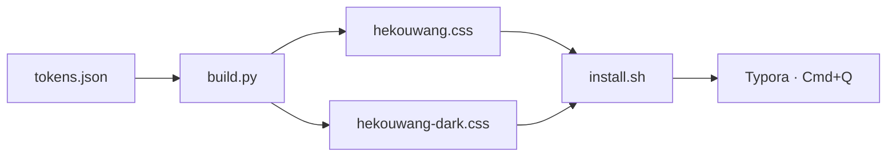
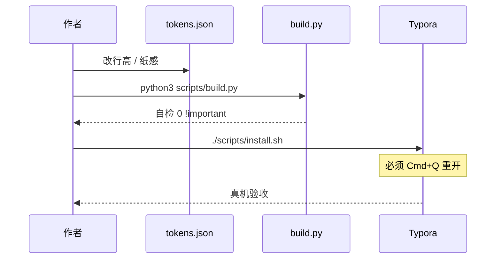
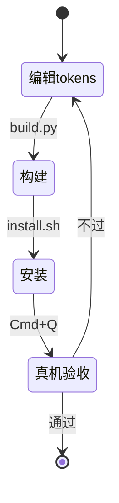
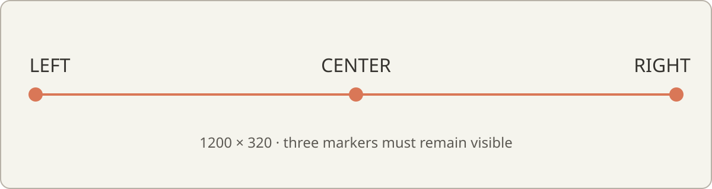

# hekouwang 主题验收样张

> ——用来验收排版，也适合直接截进 README（浅色 / 深色各一张）

这一份把 Typora 常渲染的块基本铺满。中英混排是重点：西文走 Anthropic Sans / Inter，中文 fallback 到苹方——**这不是妥协，桌面端本身就是这个机制**。我自己验收时会把本文件开着，浅深各盯三分钟。

**阅读验收基线（Hekouwang）**：正文 `1rem` · 行高 `1.65` · 段距 `0.85rem` · 随宽屏从 `48rem` 扩至最多 `96rem` 的正文阅读列 / 最多 `120em` 技术画布 · `#write` 直角白纸。宽屏时检查长段落是否实际变宽，标题、列表与六列以内的表格是否同步对齐；1–3 列小表最多 `48rem` 并左对齐正文，4–6 列填满阅读列，7+ 列使用技术画布且只留横线。代码、宽表和图片也应有足够空间。本文件后半部包含专门的压力样例。

---

## 一、正文与中英混排

我写这段是为了看长段落的呼吸感。并排对照时，西文字形应接近 Anthropic Sans / Inter，中文走苹方；行距要像在读文章，不是在扫聊天气泡。

比如这句里混着 `variable font`、opsz 轴、以及 300→800 的字重范围，看看西文和苹方交接得顺不顺。数字也要对齐：2026 年、1,247 次、99.8% 的占比、测得 `font-size: 16px` 根字号。

行内样式一次过：**加粗看字重是不是真的**、*斜体/软强调*、~~删除线~~、`行内代码`、[一个链接](https://github.com/huiyonghkw/hekouwang-typora-theme)、以及 ==高亮==。

图注应是灰字小字、**没有**每字下方的着重号：

*(图：示例图注，不应出现彩色圆点或疹子般着重号)*

### 三级标题：看字阶是否连贯

标题的负字距是高级感的主要来源，字号越大收得越多。h1 到 h4 应该形成清晰但不突兀的层级。

#### 四级标题

到这一级应该已经接近正文字号，靠字重和间距区分，而不是继续放大。

##### 五级标题

再下一档，仍靠字重，不靠装饰色。

###### 六级标题

最末级，字色可略软，别抢正文。

---

## 二、引用

> 引用块刻意没有用品牌色竖条，也不铺沉底。边界来自 8px 浅灰竖线，字色降一档。
>
> 引用里也可以有 `代码` 和**加粗**。我自己写长文时，金句引用就靠这一条浅灰竖线就够了。

> 嵌套引用：
> > 第二层应该继续保持缩进，但不叠加更重的视觉。
> >
> > > 第三层：再淡一点，别变成色块墙。

> 「如果你能找到 AI 真正『推动业务』的点，你就已经成功了一半。」

---

## 三、列表

无序列表：

- 第一项，看 marker 的颜色是不是够淡
- 第二项，带 `行内代码` 看行高有没有被撑开
- 第三项，带一点**加粗引导语**：后面跟说明文字
  - 嵌套一层
  - 再来一条，含 `npm run build`
    - 再深一层，看缩进节奏

有序列表：

1. 序号用等宽数字，多位数不会左右跳
2. 第二条看段距
3. 第三条
10. 第十条之后对齐仍然稳定
11. 第十一条

任务列表（不应出现逐条灰底卡片）：

- [x] 已完成项，勾选框是墨黑填充，文字仅淡化、无删除线
- [x] 第二个已完成
- [ ] 未完成项，只有细边框
- [ ] 看勾选框和文字基线对不对齐
  - [x] 嵌套已完成
  - [ ] 嵌套未完成

---

## 四、代码

行内的 `npm install`、`--user-data-dir`、`font-optical-sizing: auto`。

下面几块故意挨着放，用来验收**连续 fence 的呼吸**（不该糊成灰条墙）。

```python
import re

def check(css: str) -> list[str]:
    """判据必须能分辨合法与违规，一刀切等于没有区分力。"""
    problems = []
    for m in re.finditer(r"([^{}]+)\{([^{}]*)\}", css):
        selector = m.group(1).strip().split("\n")[-1].strip()
        if selector == "html":
            continue  # 合法：根字号可用 px
        for fm in re.finditer(r"font-size:\s*[\d.]+px", m.group(2)):
            problems.append(f"{selector} 里 {fm.group(0)}")
    return problems


if __name__ == "__main__":
    print(check(open("theme/hekouwang.css").read()) or "ok")
```

```bash
# 注释色、字符串色、中文注释一起看
python3 scripts/build.py      # → hekouwang.css / hekouwang-dark.css
./scripts/install.sh          # 装进 Typora（Cmd+Q 再开）
```

```css
:root {
  --hk-ink: #111827;
  --hk-muted: #6b7280;
  --hk-accent: #2e6f5e;
}

#write {
  max-width: min(120em, calc(100% - 4rem));
  line-height: 1.65;
  /* 直角白纸画在 #write，content 只做冷灰 gutter */
}

#write > p {
  max-width: min(100%, clamp(48rem, calc(100vw - 16rem), 96rem));
  margin-inline: auto; /* 示例：正文随宽屏增长，并在纸面内居中 */
}
```

```json
{
  "preset": "work",
  "type": {
    "body_size": "1rem",
    "body_lh": "1.65",
    "reading_measure": "clamp(48rem, calc(100vw - 16rem), 96rem)",
    "para_gap": "0.85rem"
  },
  "layout": { "wide_measure": "120em" },
  "paper": { "enabled": true },
  "glyphs": { "anthropic_sans": 581, "cjk": 0 }
}
```

```javascript
// 语法高亮：关键字 / 字符串 / 数字 / 注释
const readingMeasure = "clamp(48rem, calc(100vw - 16rem), 96rem)";
const technicalCanvas = "120em";
const leading = 1.65;
export function isLongForm(lh) {
  return lh >= 1.6; // 中文长文别低于这条线
}
```

```diff
--- a/scripts/tokens.json
+++ b/scripts/tokens.json
@@ -1,5 +1,5 @@
-  "reading_measure": "42em",
+  "reading_measure": "clamp(48rem, calc(100vw - 16rem), 96rem)",
-  "body_lh": "1.42857",
+  "body_lh": "1.65",
```

单行短命令（看极短 fence 会不会显得空荡或过厚）：

```text
./scripts/install.sh && echo done
```

---

## 五、表格

六列表：左右边缘应与上方正文阅读列对齐，并随窗口宽度伸缩；同时看表头辨认度、单元格垂直呼吸、数字列对齐，以及**首列是否完整**（不贴纸边）。

| 字体 | 字符数 | CJK | 可变轴 | 授权 | 备注 |
|---|---:|:---:|---|---|---|
| Anthropic Sans | 581 | 0 | wght 300–800 / opsz | 专有 | `local()` 探测 |
| Anthropic Serif | 567 | 0 | wght 300–800 / opsz | 专有 | 不默认正文 |
| Inter | 2500+ | 0 | wght 100–900 | SIL OFL | 随包分发 |
| PingFang SC | — | 全 | 静态多字重 | 系统 | 中文主力 |

四列对比表（中文长单元格折行）：同样应填满正文阅读列。

| 阶段 | 目标 | 典型场景 | 关键行动 |
|---|---|---|---|
| 内部工具 | 低成本验证 | 周报、知识库、脚本装包 | 选一个真痛点，两周内上线 |
| 工作流嵌入 | 进日常路径 | 评审、客服草稿、数据清洗 | 接到现有工具链，不另起炉灶 |
| 产品能力 | 可对外交付 | Agent、检索增强、自动报表 | 定边界与评测，再谈规模化 |

表格要看三件事：表头分隔线（无厚灰条）、单元格呼吸、右对齐数字是否稳。

---

## 六、数学公式

行内：质能方程 $E = mc^2$，以及黄金分割 $\varphi = \dfrac{1+\sqrt{5}}{2}$。

块级：

$$
\begin{aligned}
\nabla \cdot \mathbf{E} &= \frac{\rho}{\varepsilon_0} \\
\nabla \cdot \mathbf{B} &= 0 \\
\nabla \times \mathbf{E} &= -\frac{\partial \mathbf{B}}{\partial t} \\
\nabla \times \mathbf{B} &= \mu_0\mathbf{J} + \mu_0\varepsilon_0\frac{\partial \mathbf{E}}{\partial t}
\end{aligned}
$$

矩阵：

$$
\mathbf{A} = \begin{pmatrix}
a_{11} & a_{12} & a_{13} \\
a_{21} & a_{22} & a_{23} \\
a_{31} & a_{32} & a_{33}
\end{pmatrix}
$$

较长公式：缩窄窗口时应在公式区域内横向滚动；点击公式进入编辑态，公式编辑工具条应完整显示。

$$
\mathcal{L}(\theta)=\sum_{i=1}^{n}\left[-y_i\log p_\theta(x_i)-(1-y_i)\log\left(1-p_\theta(x_i)\right)\right]+\lambda\sum_{j=1}^{m}\theta_j^2
$$

---

## 七、图表（Mermaid）

浅色与深色主题都要看节点文字、连线、箭头、时序图参与者和注释是否清楚；深色主题应重新渲染为深色图表。

流程图：



时序：



状态：



---

## 八、Callout / 提示块

> [!NOTE]
> GitHub 风格 callout：左边框定语义，底色应几乎看不见。适合放「补充说明」。

> [!TIP]
> 装完主题记得 **Cmd+Q**。只切换主题菜单不会重载已改过的 CSS——我踩过不止一次。

> [!IMPORTANT]
> 边框用墨色叠透明度，不要平铺 `#ccc`；白纸上的死灰线最毁气质。

> [!WARNING]
> 别手改 `theme/*.css`。下次 `build.py` 会覆盖。改 `scripts/tokens.json`。

> [!CAUTION]
> 深色侧栏比纸面更亮，是采样结论，不是 bug。靠「浅色取反」一定会做反。

---

## 九、分隔线与其他

上面是一条 HR。再来一条：

***

定义感内容（用列表模拟）：

**栏宽 measure**  
正文阅读列随宽屏从 `48rem` 扩至最多 `96rem`；技术画布最多 `120em`。两者都受窗口与页边距限制，随窗伸缩。

**纸感 paper**  
画在 `#write` 上的纯白纸面 + 直角 + 1px 细边；侧栏 / gutter 是冷灰壳层。

**行内代码**  
深灰字 + 4% 中性浅灰底；一段里七八个也不该像疹子。

脚注示例[^1]，以及第二条[^2]。

[^1]: 脚注应比正文小一号、颜色更淡。
[^2]: 第二条脚注，看列表间距是否打架。

缩写与上标：HTML 里常见 `H~2~O` 与 `x^2^`（若开启对应扩展）。键盘感：<kbd>Cmd</kbd>+<kbd>Q</kbd>。

---

## 十、定稿截图（README / GitHub Pages）

最新图片集中在 `docs/previews/`：免费 V2 使用 `v2-light.webp` / `v2-dark.webp`，付费六套使用 `v1`、`v2-pro`、`v3` 至 `v6` 各自的 `-light.webp` / `-dark.webp`，A4 导出样张使用 `v2-export-a4.webp`。截图统一打开 [`主题展示样张.md`](./主题展示样张.md)，让标题、正文、引用、代码和表格同屏可比。

拍摄前在 Typora 中完整退出并重开，核对当前主题菜单项与侧栏、窗口底色；原生导出图还需检查 PDF 第一页及跨页内容。

---

## 十一、验收清单

逐项打钩；有一项不过就定位对应的 token 或 CSS 规则，重新构建并在 Typora 中复验：

- [ ] 连读三段不累眼，行高和段距舒服
- [ ] 中英交界无基线错位、无字重突变
- [ ] 标题字阶连贯，h1→h6 层级清晰；开篇第一枚 h2 有呼吸
- [ ] 题头署名（本文件标题下的 byline）无左边线；正文引用有粗浅灰竖线
- [ ] 加粗是真字重（边缘不虚）
- [ ] 任务列表无逐条灰卡片，完成态无删除线噪声
- [ ] 连续代码块有间距，不糊成灰墙；语法色不刺眼
- [ ] 表格首列完整、表头可辨、数字列稳定
- [ ] Mermaid / 公式可读，不炸版
- [ ] Callout 左边线清楚、底几乎看不见
- [ ] 侧栏、大纲、顶栏与正文同一套色温；壳层与纸面分层清楚
- [ ] 深色模式滚动条等原生控件跟 dark 一致

---

## 十二、宽屏长文

在 1440px 以上的窗口里，先连读下面三段，再缩到普通宽度读一遍。注意每行读到末尾后能否轻松找到下一行的开头，以及段落是否仍与标题、列表对齐。宽屏画布可以容纳复杂内容，但长段落应保持稳定的阅读节奏。

一份技术笔记往往先讲背景，再解释做法，最后列出边界。如果正文为了填满整个显示器而变得很宽，眼睛每次换行都要走更远，回到下一行开头时也更容易错位。阅读时请从这一段的第一句读到最后一句，不要只看页面是否居中；同时观察标点、英文缩写、年份和行内代码的间距，它们会在一行很长时放大排版中的小问题。

接下来把注意力放在内容的层次上。读者可能先扫标题，再跳到加粗的结论，随后回头看论证；也可能沿着段落逐句阅读，并在需要时打开旁边的大纲。段落宽度如果频繁变化，视线会不断重新建立起点。因此正文、引用和列表应形成一致的阅读列，而需要额外空间的表格、代码和图像可以按内容尺寸展开。

最后检查缩放后的体验：提高字号以后，卡片两侧仍应留有余地，长单词、路径和链接不应把整张页面撑出窗口。窗口缩小时，内容可以自然换行；确实不能拆开的技术内容应在自己的区域内滚动。连续读完这三段后，再切换深色主题重复一次，确认对比度与行距不会让文字显得过亮、过密或发灰。

---

## 十三、句中图片、宽幅图片与长链接

这个图标放在一句话中间 ，后面的文字应接着排在同一行；只在剩余空间不足时自然换行。请同时检查图标与汉字基线、前后空格和光标移动。

下面是独占一段的宽幅图。缩窄窗口或导出 PDF 时，LEFT、CENTER、RIGHT 三个标记都应看得见，图像比例应保持不变。



键盘焦点可用[这个仓库链接](https://github.com/huiyonghkw/hekouwang-typora-theme)检查。下面的长地址用于观察自动换行与溢出，不要求访问：`https://example.com/research/typora/themes/long-form-reading/2026/10/08/acceptance?window=wide&mode=source&zoom=200-percent&export=multi-page-pdf&sample=very-long-address-without-natural-breaks`。

---

## 十四、十二列表格

这张表刻意超过普通阅读列。在普通窗口和窄窗口中，表头、首列和末列都必须能通过表格自己的滚动区域看到，页面本身不应被撑出水平滚动条；宽屏则应利用空余空间减少无意义的折行。

| 方案 | 负责人 | 阶段 | 用户场景 | 设备 | 系统 | 语言 | 字号 | 文字对比 | 代码换行 | 表格滚动 | PDF 导出 |
|---|---|---|---|---|---|---|---:|---|---|---|---|
| A · 长文阅读 | 内容团队 | 评审 | 连续阅读三段以上的中文说明 | 笔记本 | macOS | 中文 / English | 100% | 链接与注释清楚 | 开 | 可到末列 | A4 多页 |
| B · 技术记录 | 开发团队 | 试用 | 同时查看命令、日志和宽表 | 外接屏 | Windows | English / 中文 | 125% | 语法颜色可辨 | 关 | 可到末列 | A4 多页 |
| C · 放大阅读 | 编辑团队 | 验收 | 高倍率阅读并编辑任务列表 | 窄窗口 | macOS | 中文 | 200% | 焦点与勾选框可见 | 开 / 关 | 可到末列 | A4 多页 |

---

## 十五、超过 200 字符的单行代码

在 Typora 偏好设置里分别开启和关闭代码自动换行。开启时这一行应完整可读、代码块高度增加；关闭时应能在代码块内部水平滚动，且正文、纸面和侧栏不被一起推宽。再用鼠标或键盘把光标移到行尾，确认可编辑。

```javascript
const payload = {documentId:"typora-reading-acceptance-2026-10-08",windowWidth:1920,viewport:"desktop-wide-screen",readingMode:"long-form-chinese-prose",sourceMode:true,focusMode:false,zoom:"200-percent",codeWrapping:false,exportTarget:"a4-multipage-pdf",columns:["owner","status","language","contrast","keyboard-focus","horizontal-overflow","last-visible-column"]};
```

---

## 十六、模式与导出验收矩阵

同一份文件在浅色和深色主题各跑一遍。窗口宽度只需接近下列档位；重点是观察实际编辑与阅读行为，而不只是截一张静态图。

| 场景 | 操作 | 验收重点 |
|---|---|---|
| 普通阅读 | 普通窗口、默认字号 | 正文换行、标题和列表对齐，链接与代码注释清楚 |
| 宽屏阅读 | 先看约 1440px，再看约 1800px 或更宽 | 正文阅读列从约 `48rem` 增至接近 `96rem`，标题、列表、六列以内的表格与正文左边缘对齐；宽表和代码可利用更多空间 |
| 窄窗放大 | 窗口约 800px 或更窄，字号 / 显示缩放约 200% | 不丢文字，不出现整页横向滚动；链接、图像可收缩 |
| 源码模式 | 切换 Typora 源码模式，重复宽屏与窄窗 | 编辑区宽度、字体和光标位置合理，长行可到达末尾 |
| 专注模式 | 光标依次置于正文、图片、任务框和代码块 | 当前块清晰，其他块弱化适度；减少动态效果设置下无多余过渡 |
| 公式和图表 | 在浅色、深色主题中查看块级公式和三种 Mermaid 图表 | 公式边框与文字清楚，长公式局部滚动；图表节点、箭头与标签可辨 |
| 浮动工具栏 | Typora「视图 → 工具栏」打开后，用键盘操作按钮与菜单 | 常态图标、悬停和焦点清楚；不遮挡正文或改变原生收起行为 |
| 代码换行 | 偏好设置中开、关代码自动换行 | 上一节的长行完整可读或可在代码块内滚动 |
| PDF 导出 | 导出完整文件的 A4 多页 PDF | 首页、第二页和末页留白正常；表格、代码、图像不裁切 |

补充检查：

- [ ] 句中图片不被强制单独成段；独占一段的宽图按比例缩小，左右标记完整
- [ ] 超宽表格能到达第 12 列，表内文字仍容易辨认
- [ ] 超长代码在自动换行开 / 关两种状态下都能读到最后一个字符
- [ ] 链接在默认、悬停和键盘焦点状态下均可识别；任务框轮廓清楚
- [ ] 源码模式、专注模式、浅色和深色主题的内容宽度与颜色稳定
- [ ] 放大约 200% 后没有正文、图片或表格被不可恢复地裁掉
- [ ] 深色 Mermaid 的标签、箭头和时序注释可读；公式编辑工具条没有被边框裁切
- [ ] 浮动工具栏的按钮、菜单和提示文字在浅色、深色主题中均可读，键盘焦点可见
- [ ] A4 PDF 的第二页与末页也有合适页边距，跨页内容保持完整
